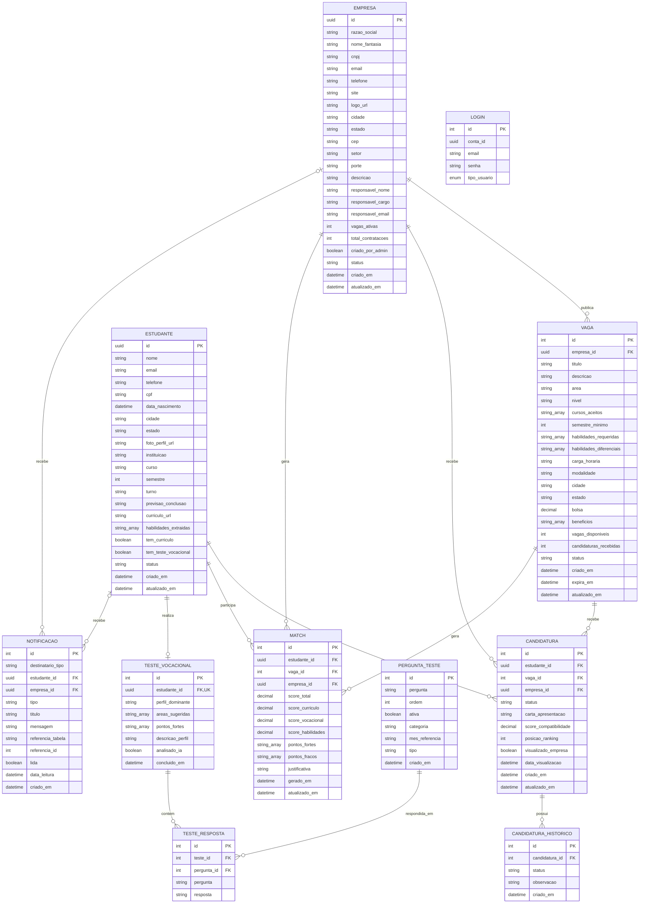

# OpenDoors — Documentação dos Modelos para Diagrama ER e ORM

> **Objetivo:** servir de base para a criação do Diagrama de Entidade-Relacionamento (DER) e posterior modelagem de ORM, na migração do Supabase para um banco em nuvem.
> **Origem:** classes C# do namespace `OpenDoors.Api.Models` (pasta `Model`), anotadas com `[Table]`, `[Column]` e `[PrimaryKey]` (Supabase / postgrest-csharp).
> **Princípio:** nenhuma informação foi inventada ou alterada. Apenas os nomes foram padronizados para SQL. O que não está explícito no código está em [Pontos de Atenção](#9-pontos-de-atenção-e-premissas-a-validar).

---

## Sumário

1. [Convenções deste documento](#1-convenções-deste-documento)
2. [Visão geral das entidades](#2-visão-geral-das-entidades)
3. [Entidades de domínio](#3-entidades-de-domínio) — `Empresa`, `Estudante`, `Vaga`
4. [Entidades de processo seletivo](#4-entidades-de-processo-seletivo) — `Candidatura`, `Candidatura_Historico`, `Match`
5. [Entidades de teste vocacional](#5-entidades-de-teste-vocacional) — `Teste_Vocacional`, `Pergunta_Teste`, `Teste_Resposta`
6. [Entidades de suporte](#6-entidades-de-suporte) — `Login`, `Notificacao`
7. [Relacionamentos](#7-relacionamentos)
8. [Rascunho do DER (Mermaid)](#8-rascunho-do-der-mermaid)
9. [Pontos de atenção e premissas a validar](#9-pontos-de-atenção-e-premissas-a-validar)

---

## 1. Convenções deste documento

### 1.1 Nomenclatura

| Item | Regra aplicada | Exemplo |
|---|---|---|
| Entidade | `Pascal_Snake_Case`, singular | `CandidaturaHistorico` → `Candidatura_Historico` |
| Atributo | `snake_case` em minúsculas (mesmo padrão das colunas do Supabase) | `estudante_id`, `carta_apresentacao` |
| Tabela / coluna original | Mantidas em coluna própria, para rastreabilidade | `candidaturas_historico` |

### 1.2 Mapeamento de tipos (C# → SQL sugerido)

| Tipo C# | Tipo SQL sugerido | Observação |
|---|---|---|
| `Guid` | `UUID` | |
| `int` (PK gerada pelo banco) | `INT` com auto-incremento (`IDENTITY` / `SERIAL`) | |
| `int` / `int?` | `INT` | |
| `string` / `string?` | `VARCHAR` / `TEXT` | O código não define tamanho máximo. |
| `decimal` / `decimal?` | `DECIMAL` | O código não define precisão/escala. |
| `bool` / `bool?` | `BOOLEAN` | |
| `DateTime` / `DateTime?` | `TIMESTAMP` | O código não define se há fuso horário. |
| `List<string>` / `List<string>?` | `TEXT[]` (array) | Ver [item 9.3](#93-colunas-com-lista-de-strings-listastring). |
| `enum TiposUsuario` | Ver entidade `Login` | Ver [item 9.4](#94-enum-tiposusuario-em-login). |

### 1.3 Legenda das colunas

| Coluna | Significado |
|---|---|
| **Nulável** | `Sim` quando o tipo C# é nulável (`?`); `Não` caso contrário. |
| **Chave** | `PK` = chave primária; `FK` = chave estrangeira *inferida*; `UQ` = único. |
| **Padrão (C#)** | Valor inicial definido na classe C#. É um *inicializador de código*, não necessariamente um `DEFAULT` do banco. |

> **Importante:** o código C# **não declara** constraints de FK nem de `UNIQUE`. As FKs foram inferidas pelo nome do campo (`*_id`) e pelos comentários do código. Os `UQ` constam apenas onde um comentário no código afirma unicidade.

---

## 2. Visão geral das entidades

| # | Entidade (SQL) | Classe C# | Tabela original | PK | Tipo da PK |
|---|---|---|---|---|---|
| 1 | `Candidatura` | `Candidatura` | `candidaturas` | `id` | `INT` gerada pelo banco |
| 2 | `Candidatura_Historico` | `CandidaturaHistorico` | `candidaturas_historico` | `id` | `INT` gerada pelo banco |
| 3 | `Empresa` | `Empresa` | `empresas` | `id` | `UUID` enviada pela aplicação |
| 4 | `Estudante` | `Estudante` | `estudantes` | `id` | `UUID` enviada pela aplicação |
| 5 | `Login` | `Login` | `logins` | `id` | `INT` gerada pelo banco |
| 6 | `Match` | `Match` | `matches` | `id` | `INT` gerada pelo banco |
| 7 | `Notificacao` | `Notificacao` | `notificacoes` | `id` | `INT` gerada pelo banco |
| 8 | `Pergunta_Teste` | `PerguntaTeste` | `perguntas_teste` | `id` | `INT` gerada pelo banco |
| 9 | `Teste_Resposta` | `TesteResposta` | `testes_respostas` | `id` | `INT` gerada pelo banco |
| 10 | `Teste_Vocacional` | `TesteVocacional` | `testes_vocacionais` | `id` | `INT` gerada pelo banco |
| 11 | `Vaga` | `Vaga` | `vagas` | `id` | `INT` gerada pelo banco |

Também existe o `enum TiposUsuario` (`Estudante`, `Empresa`), declarado junto à classe `Login`.

> **PK gerada pelo banco vs. enviada pela aplicação:** `[PrimaryKey("id", false)]` indica valor gerado pelo banco; `[PrimaryKey("id", true)]` indica que a aplicação envia o valor (caso de `Empresa` e `Estudante`, cujo UUID vem do Supabase Auth).

---

## 3. Entidades de domínio

### 3.1 `Empresa`

- **Classe C#:** `Empresa` | **Tabela original:** `empresas`
- **PK:** `id` (`UUID`, **enviada pela aplicação**, originada no Supabase Auth)

| Atributo (SQL) | Coluna original / Propriedade C# | Tipo C# | Tipo SQL | Nulável | Chave | Observações |
|---|---|---|---|---|---|---|
| `id` | `id` / `Id` | `Guid` | `UUID` | Não | PK | Vem do Supabase Auth; não é gerado pelo banco. |
| `razao_social` | `razao_social` / `RazaoSocial` | `string` | `VARCHAR` | Não | | Padrão C#: `string.Empty` |
| `nome_fantasia` | `nome_fantasia` / `NomeFantasia` | `string?` | `VARCHAR` | Sim | | |
| `cnpj` | `cnpj` / `Cnpj` | `string` | `VARCHAR` | Não | | Padrão C#: `string.Empty` |
| `email` | `email` / `Email` | `string` | `VARCHAR` | Não | | Padrão C#: `string.Empty` |
| `telefone` | `telefone` / `Telefone` | `string?` | `VARCHAR` | Sim | | |
| `site` | `site` / `Site` | `string?` | `VARCHAR` | Sim | | |
| `logo_url` | `logo_url` / `LogoUrl` | `string?` | `VARCHAR` | Sim | | |
| `cidade` | `cidade` / `Cidade` | `string?` | `VARCHAR` | Sim | | |
| `estado` | `estado` / `Estado` | `string?` | `VARCHAR` | Sim | | |
| `cep` | `cep` / `Cep` | `string?` | `VARCHAR` | Sim | | |
| `setor` | `setor` / `Setor` | `string?` | `VARCHAR` | Sim | | |
| `porte` | `porte` / `Porte` | `string?` | `VARCHAR` | Sim | | |
| `descricao` | `descricao` / `Descricao` | `string?` | `TEXT` | Sim | | |
| `responsavel_nome` | `responsavel_nome` / `ResponsavelNome` | `string?` | `VARCHAR` | Sim | | |
| `responsavel_cargo` | `responsavel_cargo` / `ResponsavelCargo` | `string?` | `VARCHAR` | Sim | | |
| `responsavel_email` | `responsavel_email` / `ResponsavelEmail` | `string?` | `VARCHAR` | Sim | | |
| `vagas_ativas` | `vagas_ativas` / `VagasAtivas` | `int?` | `INT` | Sim | | Contador (campo agregado). |
| `total_contratacoes` | `total_contratacoes` / `TotalContratacoes` | `int?` | `INT` | Sim | | Contador (campo agregado). |
| `criado_por_admin` | `criado_por_admin` / `CriadoPorAdmin` | `bool?` | `BOOLEAN` | Sim | | |
| `status` | `status` / `Status` | `string?` | `VARCHAR` | Sim | | Valores possíveis não documentados no código. |
| `criado_em` | `criado_em` / `CriadoEm` | `DateTime?` | `TIMESTAMP` | Sim | | |
| `atualizado_em` | `atualizado_em` / `AtualizadoEm` | `DateTime?` | `TIMESTAMP` | Sim | | |

### 3.2 `Estudante`

- **Classe C#:** `Estudante` | **Tabela original:** `estudantes`
- **PK:** `id` (`UUID`, **enviada pela aplicação**, originada no Supabase Auth, igual a `Empresa`)

| Atributo (SQL) | Coluna original / Propriedade C# | Tipo C# | Tipo SQL | Nulável | Chave | Observações |
|---|---|---|---|---|---|---|
| `id` | `id` / `Id` | `Guid` | `UUID` | Não | PK | Vem do Supabase Auth; não é gerado pelo banco. |
| `nome` | `nome` / `Nome` | `string` | `VARCHAR` | Não | | Padrão C#: `string.Empty` |
| `email` | `email` / `Email` | `string` | `VARCHAR` | Não | | Padrão C#: `string.Empty` |
| `telefone` | `telefone` / `Telefone` | `string?` | `VARCHAR` | Sim | | |
| `cpf` | `cpf` / `Cpf` | `string?` | `VARCHAR` | Sim | | |
| `data_nascimento` | `data_nascimento` / `DataNascimento` | `DateTime?` | `TIMESTAMP` | Sim | | |
| `cidade` | `cidade` / `Cidade` | `string?` | `VARCHAR` | Sim | | |
| `estado` | `estado` / `Estado` | `string?` | `VARCHAR` | Sim | | |
| `foto_perfil_url` | `foto_perfil_url` / `FotoPerfilUrl` | `string?` | `VARCHAR` | Sim | | |
| `instituicao` | `instituicao` / `Instituicao` | `string?` | `VARCHAR` | Sim | | |
| `curso` | `curso` / `Curso` | `string?` | `VARCHAR` | Sim | | |
| `semestre` | `semestre` / `Semestre` | `int?` | `INT` | Sim | | |
| `turno` | `turno` / `Turno` | `string?` | `VARCHAR` | Sim | | |
| `previsao_conclusao` | `previsao_conclusao` / `PrevisaoConclusao` | `string?` | `VARCHAR` | Sim | | Tipo `string` no código (não é data). |
| `curriculo_url` | `curriculo_url` / `CurriculoUrl` | `string?` | `VARCHAR` | Sim | | |
| `habilidades_extraidas` | `habilidades_extraidas` / `HabilidadesExtraidas` | `List<string>?` | `TEXT[]` | Sim | | Lista de strings. Ver [9.3](#93-colunas-com-lista-de-strings-listastring). |
| `tem_curriculo` | `tem_curriculo` / `TemCurriculo` | `bool?` | `BOOLEAN` | Sim | | |
| `tem_teste_vocacional` | `tem_teste_vocacional` / `TemTesteVocacional` | `bool?` | `BOOLEAN` | Sim | | |
| `status` | `status` / `Status` | `string?` | `VARCHAR` | Sim | | Valores possíveis não documentados no código. |
| `criado_em` | `criado_em` / `CriadoEm` | `DateTime?` | `TIMESTAMP` | Sim | | |
| `atualizado_em` | `atualizado_em` / `AtualizadoEm` | `DateTime?` | `TIMESTAMP` | Sim | | |

### 3.3 `Vaga`

- **Classe C#:** `Vaga` | **Tabela original:** `vagas`
- **PK:** `id` (`INT`, gerada pelo banco)

| Atributo (SQL) | Coluna original / Propriedade C# | Tipo C# | Tipo SQL | Nulável | Chave | Observações |
|---|---|---|---|---|---|---|
| `id` | `id` / `Id` | `int` | `INT` (auto-incremento) | Não | PK | Gerada pelo banco. |
| `empresa_id` | `empresa_id` / `EmpresaId` | `Guid` | `UUID` | Não | FK → `Empresa.id` | |
| `titulo` | `titulo` / `Titulo` | `string` | `VARCHAR` | Não | | Padrão C#: `string.Empty` |
| `descricao` | `descricao` / `Descricao` | `string?` | `TEXT` | Sim | | |
| `area` | `area` / `Area` | `string?` | `VARCHAR` | Sim | | |
| `nivel` | `nivel` / `Nivel` | `string?` | `VARCHAR` | Sim | | |
| `cursos_aceitos` | `cursos_aceitos` / `CursosAceitos` | `List<string>?` | `TEXT[]` | Sim | | Lista de strings. |
| `semestre_minimo` | `semestre_minimo` / `SemestreMinimo` | `int?` | `INT` | Sim | | |
| `habilidades_requeridas` | `habilidades_requeridas` / `HabilidadesRequeridas` | `List<string>?` | `TEXT[]` | Sim | | Lista de strings. |
| `habilidades_diferenciais` | `habilidades_diferenciais` / `HabilidadesDiferenciais` | `List<string>?` | `TEXT[]` | Sim | | Lista de strings. |
| `carga_horaria` | `carga_horaria` / `CargaHoraria` | `string?` | `VARCHAR` | Sim | | Tipo `string` no código. |
| `modalidade` | `modalidade` / `Modalidade` | `string?` | `VARCHAR` | Sim | | |
| `cidade` | `cidade` / `Cidade` | `string?` | `VARCHAR` | Sim | | |
| `estado` | `estado` / `Estado` | `string?` | `VARCHAR` | Sim | | |
| `bolsa` | `bolsa` / `Bolsa` | `decimal?` | `DECIMAL` | Sim | | Valor monetário (precisão não definida). |
| `beneficios` | `beneficios` / `Beneficios` | `List<string>?` | `TEXT[]` | Sim | | Lista de strings. |
| `vagas_disponiveis` | `vagas_disponiveis` / `VagasDisponiveis` | `int?` | `INT` | Sim | | |
| `candidaturas_recebidas` | `candidaturas_recebidas` / `CandidaturasRecebidas` | `int?` | `INT` | Sim | | Contador (campo agregado). |
| `status` | `status` / `Status` | `string?` | `VARCHAR` | Sim | | Valores possíveis não documentados no código. |
| `criado_em` | `criado_em` / `CriadoEm` | `DateTime?` | `TIMESTAMP` | Sim | | |
| `expira_em` | `expira_em` / `ExpiraEm` | `DateTime?` | `TIMESTAMP` | Sim | | |
| `atualizado_em` | `atualizado_em` / `AtualizadoEm` | `DateTime?` | `TIMESTAMP` | Sim | | |

---

## 4. Entidades de processo seletivo

### 4.1 `Candidatura`

- **Classe C#:** `Candidatura` | **Tabela original:** `candidaturas`
- **PK:** `id` (`INT`, gerada pelo banco, "igual a Vaga")
- Comentário no código: *"três conexões importantes"* (Estudante, Vaga, Empresa).

| Atributo (SQL) | Coluna original / Propriedade C# | Tipo C# | Tipo SQL | Nulável | Chave | Observações |
|---|---|---|---|---|---|---|
| `id` | `id` / `Id` | `int` | `INT` (auto-incremento) | Não | PK | Gerada pelo banco. |
| `estudante_id` | `estudante_id` / `EstudanteId` | `Guid` | `UUID` | Não | FK → `Estudante.id` | |
| `vaga_id` | `vaga_id` / `VagaId` | `int` | `INT` | Não | FK → `Vaga.id` | |
| `empresa_id` | `empresa_id` / `EmpresaId` | `Guid` | `UUID` | Não | FK → `Empresa.id` | |
| `status` | `status` / `Status` | `string?` | `VARCHAR` | Sim | | Valores citados no código: `"pendente"`, `"analisando"`, `"aprovada"`, `"rejeitada"`. |
| `carta_apresentacao` | `carta_apresentacao` / `CartaApresentacao` | `string?` | `TEXT` | Sim | | Carta opcional escrita pelo estudante. |
| `score_compatibilidade` | `score_compatibilidade` / `ScoreCompatibilidade` | `decimal?` | `DECIMAL` | Sim | | Faixa de 0 a 100, calculada por IA (perfil do estudante × requisitos da vaga). |
| `posicao_ranking` | `posicao_ranking` / `PosicaoRanking` | `int?` | `INT` | Sim | | Posição no ranking (ex.: 1ª = maior score). |
| `visualizado_empresa` | `visualizado_empresa` / `VisualizadoEmpresa` | `bool?` | `BOOLEAN` | Sim | | Indica se a empresa já visualizou. |
| `data_visualizacao` | `data_visualizacao` / `DataVisualizacao` | `DateTime?` | `TIMESTAMP` | Sim | | |
| `criado_em` | `criado_em` / `CriadoEm` | `DateTime?` | `TIMESTAMP` | Sim | | |
| `atualizado_em` | `atualizado_em` / `AtualizadoEm` | `DateTime?` | `TIMESTAMP` | Sim | | |

### 4.2 `Candidatura_Historico`

- **Classe C#:** `CandidaturaHistorico` | **Tabela original:** `candidaturas_historico`
- **PK:** `id` (`INT`, gerada pelo banco)

| Atributo (SQL) | Coluna original / Propriedade C# | Tipo C# | Tipo SQL | Nulável | Chave | Observações |
|---|---|---|---|---|---|---|
| `id` | `id` / `Id` | `int` | `INT` (auto-incremento) | Não | PK | Gerada pelo banco. |
| `candidatura_id` | `candidatura_id` / `CandidaturaId` | `int` | `INT` | Não | FK → `Candidatura.id` | |
| `status` | `status` / `Status` | `string` | `VARCHAR` | Não | | Padrão C#: `string.Empty` |
| `observacao` | `observacao` / `Observacao` | `string?` | `TEXT` | Sim | | |
| `criado_em` | `criado_em` / `CriadoEm` | `DateTime?` | `TIMESTAMP` | Sim | | |

### 4.3 `Match`

- **Classe C#:** `Match` | **Tabela original:** `matches`
- **PK:** `id` (`INT`, gerada pelo banco)
- Representa a compatibilidade calculada por IA entre um estudante e uma vaga de uma empresa.

| Atributo (SQL) | Coluna original / Propriedade C# | Tipo C# | Tipo SQL | Nulável | Chave | Observações |
|---|---|---|---|---|---|---|
| `id` | `id` / `Id` | `int` | `INT` (auto-incremento) | Não | PK | Gerada pelo banco. |
| `estudante_id` | `estudante_id` / `EstudanteId` | `Guid` | `UUID` | Não | FK → `Estudante.id` | |
| `vaga_id` | `vaga_id` / `VagaId` | `int` | `INT` | Não | FK → `Vaga.id` | |
| `empresa_id` | `empresa_id` / `EmpresaId` | `Guid` | `UUID` | Não | FK → `Empresa.id` | |
| `score_total` | `score_total` / `ScoreTotal` | `decimal` | `DECIMAL` | Não | | Faixa de 0 a 100. Score principal calculado por IA. |
| `score_curriculo` | `score_curriculo` / `ScoreCurriculo` | `decimal?` | `DECIMAL` | Sim | | Score parcial (1 de 3 dimensões). |
| `score_vocacional` | `score_vocacional` / `ScoreVocacional` | `decimal?` | `DECIMAL` | Sim | | Score parcial (1 de 3 dimensões). |
| `score_habilidades` | `score_habilidades` / `ScoreHabilidades` | `decimal?` | `DECIMAL` | Sim | | Score parcial (1 de 3 dimensões). |
| `pontos_fortes` | `pontos_fortes` / `PontosFortes` | `List<string>?` | `TEXT[]` | Sim | | Pontos em que o estudante se destaca. |
| `pontos_fracos` | `pontos_fracos` / `PontosFracos` | `List<string>?` | `TEXT[]` | Sim | | Pontos a melhorar. |
| `justificativa` | `justificativa` / `Justificativa` | `string?` | `TEXT` | Sim | | Texto narrativo explicando o match. |
| `gerado_em` | `gerado_em` / `GeradoEm` | `DateTime?` | `TIMESTAMP` | Sim | | |
| `atualizado_em` | `atualizado_em` / `AtualizadoEm` | `DateTime?` | `TIMESTAMP` | Sim | | |

---

## 5. Entidades de teste vocacional

### 5.1 `Teste_Vocacional`

- **Classe C#:** `TesteVocacional` | **Tabela original:** `testes_vocacionais`
- **PK:** `id` (`INT`, gerada pelo banco)
- Comentário no código: *"UNIQUE — cada estudante tem 1 teste só"*.

| Atributo (SQL) | Coluna original / Propriedade C# | Tipo C# | Tipo SQL | Nulável | Chave | Observações |
|---|---|---|---|---|---|---|
| `id` | `id` / `Id` | `int` | `INT` (auto-incremento) | Não | PK | Gerada pelo banco. |
| `estudante_id` | `estudante_id` / `EstudanteId` | `Guid` | `UUID` | Não | FK → `Estudante.id`, **UQ** | Unicidade conforme comentário no código. |
| `perfil_dominante` | `perfil_dominante` / `PerfilDominante` | `string?` | `VARCHAR` | Sim | | Exemplos no código: `"Analítico"`, `"Criativo"`, `"Comunicativo"`. |
| `areas_sugeridas` | `areas_sugeridas` / `AreasSugeridas` | `List<string>?` | `TEXT[]` | Sim | | Ex.: `["Análise de Dados", "Engenharia de Software", "BI"]`. |
| `pontos_fortes` | `pontos_fortes` / `PontosFortes` | `List<string>?` | `TEXT[]` | Sim | | Pontos fortes identificados. |
| `descricao_perfil` | `descricao_perfil` / `DescricaoPerfil` | `string?` | `TEXT` | Sim | | Descrição textual do perfil. |
| `analisado_ia` | `analisado_ia` / `AnalisadoIa` | `bool?` | `BOOLEAN` | Sim | | Flag: a IA já analisou o teste? |
| `concluido_em` | `concluido_em` / `ConcluidoEm` | `DateTime?` | `TIMESTAMP` | Sim | | |

### 5.2 `Pergunta_Teste`

- **Classe C#:** `PerguntaTeste` | **Tabela original:** `perguntas_teste`
- **PK:** `id` (`INT`, gerada pelo banco)

| Atributo (SQL) | Coluna original / Propriedade C# | Tipo C# | Tipo SQL | Nulável | Chave | Padrão (C#) | Observações |
|---|---|---|---|---|---|---|---|
| `id` | `id` / `Id` | `int` | `INT` (auto-incremento) | Não | PK | | Gerada pelo banco. |
| `pergunta` | `pergunta` / `Pergunta` | `string` | `TEXT` | Não | | `string.Empty` | |
| `ordem` | `ordem` / `Ordem` | `int` | `INT` | Não | | | |
| `ativa` | `ativa` / `Ativa` | `bool` | `BOOLEAN` | Não | | `true` | |
| `categoria` | `categoria` / `Categoria` | `string` | `VARCHAR` | Não | | `"geral"` | Exemplos no código: `"RIASEC_Realista"`, `"BigFive_Abertura"`, `"mensal_lideranca"`. |
| `mes_referencia` | `mes_referencia` / `MesReferencia` | `string?` | `VARCHAR` | Sim | | | `NULL` = pergunta fixa permanente. Preenchido = pergunta mensal, ex.: `"2025-06"`. |
| `tipo` | `tipo` / `Tipo` | `string` | `VARCHAR` | Não | | `"fixa"` | Valores: `"fixa"` ou `"mensal"`. |
| `criado_em` | `criado_em` / `CriadoEm` | `DateTime?` | `TIMESTAMP` | Sim | | | |

### 5.3 `Teste_Resposta`

- **Classe C#:** `TesteResposta` | **Tabela original:** `testes_respostas`
- **PK:** `id` (`INT`, gerada pelo banco)

| Atributo (SQL) | Coluna original / Propriedade C# | Tipo C# | Tipo SQL | Nulável | Chave | Observações |
|---|---|---|---|---|---|---|
| `id` | `id` / `Id` | `int` | `INT` (auto-incremento) | Não | PK | Gerada pelo banco. |
| `teste_id` | `teste_id` / `TesteId` | `int` | `INT` | Não | FK → `Teste_Vocacional.id` | |
| `pergunta_id` | `pergunta_id` / `PerguntaId` | `int` | `INT` | Não | FK → `Pergunta_Teste.id` | |
| `pergunta` | `pergunta` / `Pergunta` | `string` | `TEXT` | Não | | Padrão C#: `string.Empty`. Texto da pergunta armazenado junto à resposta. |
| `resposta` | `resposta` / `Resposta` | `string` | `TEXT` | Não | | Padrão C#: `string.Empty` |

---

## 6. Entidades de suporte

### 6.1 `Login`

- **Classe C#:** `Login` | **Tabela original:** `logins`
- **PK:** `id` (`INT`, gerada pelo banco)

| Atributo (SQL) | Coluna original / Propriedade C# | Tipo C# | Tipo SQL | Nulável | Chave | Observações |
|---|---|---|---|---|---|---|
| `id` | `id` / `Id` | `int` | `INT` (auto-incremento) | Não | PK | Gerada pelo banco. |
| `conta_id` | `conta_id` / `ContaId` | `Guid` | `UUID` | Não | Referência **polimórfica** | Aponta para `Estudante.id` **ou** `Empresa.id`, conforme `tipo_usuario`. Ver [9.2](#92-referências-polimórficas). |
| `email` | `email` / `Email` | `string` | `VARCHAR` | Não | | Sem valor inicial no código. |
| `senha` | `senha` / `Senha` | `string` | `VARCHAR` | Não | | Sem valor inicial no código. |
| `tipo_usuario` | `tipo_usuario` / `TipoUsuario` | `TiposUsuario` (enum) | Ver abaixo | Não | | Padrão C#: `new TiposUsuario()` (primeiro valor do enum, `Estudante`). |

**Enum `TiposUsuario`:**

| Nome | Valor ordinal (C#) |
|---|---|
| `Estudante` | 0 |
| `Empresa` | 1 |

### 6.2 `Notificacao`

- **Classe C#:** `Notificacao` | **Tabela original:** `notificacoes`
- **PK:** `id` (`INT`, gerada pelo banco)

| Atributo (SQL) | Coluna original / Propriedade C# | Tipo C# | Tipo SQL | Nulável | Chave | Observações |
|---|---|---|---|---|---|---|
| `id` | `id` / `Id` | `int` | `INT` (auto-incremento) | Não | PK | Gerada pelo banco. |
| `destinatario_tipo` | `destinatario_tipo` / `DestinatarioTipo` | `string` | `VARCHAR` | Não | | Valores: `"estudante"` ou `"empresa"`. Define quem recebe. Padrão C#: `string.Empty`. |
| `estudante_id` | `estudante_id` / `EstudanteId` | `Guid?` | `UUID` | Sim | FK → `Estudante.id` | Um dos dois (`estudante_id` ou `empresa_id`) é `NULL`, conforme o destinatário. |
| `empresa_id` | `empresa_id` / `EmpresaId` | `Guid?` | `UUID` | Sim | FK → `Empresa.id` | Idem acima. |
| `tipo` | `tipo` / `Tipo` | `string` | `VARCHAR` | Não | | Exemplos no código: `"candidatura_recebida"`, `"match_novo"`, `"vaga_atualizada"`, etc. Padrão C#: `string.Empty`. |
| `titulo` | `titulo` / `Titulo` | `string` | `VARCHAR` | Não | | Padrão C#: `string.Empty` |
| `mensagem` | `mensagem` / `Mensagem` | `string` | `TEXT` | Não | | Padrão C#: `string.Empty` |
| `referencia_tabela` | `referencia_tabela` / `ReferenciaTabela` | `string?` | `VARCHAR` | Sim | | Nome da tabela referenciada (ex.: vagas, candidaturas). |
| `referencia_id` | `referencia_id` / `ReferenciaId` | `int?` | `INT` | Sim | Referência **polimórfica** | ID do registro na tabela indicada por `referencia_tabela`. Ver [9.2](#92-referências-polimórficas). |
| `lida` | `lida` / `Lida` | `bool?` | `BOOLEAN` | Sim | | |
| `data_leitura` | `data_leitura` / `DataLeitura` | `DateTime?` | `TIMESTAMP` | Sim | | |
| `criado_em` | `criado_em` / `CriadoEm` | `DateTime?` | `TIMESTAMP` | Sim | | |

---

## 7. Relacionamentos

> Todos **inferidos** pelos nomes `*_id` e pelos comentários do código; o C# não declara FKs. A cardinalidade do lado "pai" (opcional/obrigatório) segue a nulabilidade da coluna.

| # | Entidade pai (1) | Entidade filha (N) | FK na filha | Cardinalidade | FK obrigatória? | Observação |
|---|---|---|---|---|---|---|
| R1 | `Empresa` | `Vaga` | `empresa_id` | 1 : N | Sim | |
| R2 | `Estudante` | `Candidatura` | `estudante_id` | 1 : N | Sim | |
| R3 | `Vaga` | `Candidatura` | `vaga_id` | 1 : N | Sim | |
| R4 | `Empresa` | `Candidatura` | `empresa_id` | 1 : N | Sim | Também derivável via `Vaga`. Ver [9.5](#95-campos-redundantes-e-agregados). |
| R5 | `Candidatura` | `Candidatura_Historico` | `candidatura_id` | 1 : N | Sim | |
| R6 | `Estudante` | `Match` | `estudante_id` | 1 : N | Sim | |
| R7 | `Vaga` | `Match` | `vaga_id` | 1 : N | Sim | |
| R8 | `Empresa` | `Match` | `empresa_id` | 1 : N | Sim | Também derivável via `Vaga`. |
| R9 | `Estudante` | `Teste_Vocacional` | `estudante_id` | 1 : 1 | Sim | `UNIQUE` conforme comentário no código. |
| R10 | `Teste_Vocacional` | `Teste_Resposta` | `teste_id` | 1 : N | Sim | |
| R11 | `Pergunta_Teste` | `Teste_Resposta` | `pergunta_id` | 1 : N | Sim | |
| R12 | `Estudante` | `Notificacao` | `estudante_id` | 1 : N | **Não** (opcional) | Mutuamente exclusiva com R13. |
| R13 | `Empresa` | `Notificacao` | `empresa_id` | 1 : N | **Não** (opcional) | Mutuamente exclusiva com R12. |
| R14 | `Estudante` / `Empresa` | `Login` | `conta_id` | 1 : N *(polimórfico)* | Sim | Alvo definido por `tipo_usuario`. |
| R15 | Várias tabelas | `Notificacao` | `referencia_tabela` + `referencia_id` | N : 1 *(polimórfico)* | Não | Alvo definido por `referencia_tabela`. |

---

## 8. Rascunho do DER (Mermaid)

> Rascunho de apoio. Os relacionamentos polimórficos (R14 e R15) **não** são representados como linhas, pois não são FKs simples.

---

## 9. Pontos de atenção e premissas a validar

Itens que **não estão explícitos no código** ou que exigem decisão na migração. Nenhum deles foi assumido neste documento.

### 9.1 Constraints não declaradas no código
- FKs, `UNIQUE`, `NOT NULL` e `DEFAULT` reais **não aparecem** nas classes C#; elas existem (ou não) no schema do Supabase. Recomenda-se **extrair o DDL real** do Supabase para confrontar com este documento.
- Única unicidade citada em comentário: `Teste_Vocacional.estudante_id`.
- Não há indicação de unicidade para `(estudante_id, vaga_id)` em `Candidatura` ou `Match`. Validar se existe regra de negócio.
- Políticas de exclusão (`ON DELETE CASCADE`, `RESTRICT` etc.) são desconhecidas.

### 9.2 Referências polimórficas
- **`Login.conta_id`:** aponta para `Estudante.id` ou `Empresa.id`, conforme `tipo_usuario`. Não pode ser FK simples.
- **`Notificacao.referencia_tabela` + `referencia_id`:** aponta para registros de tabelas diferentes (ex.: vagas, candidaturas). `referencia_id` é `INT`, portanto só referencia tabelas com PK `INT`.
- **`Notificacao.estudante_id` / `empresa_id`:** exclusividade mútua (um é `NULL`) garantida apenas por convenção, conforme `destinatario_tipo`.

### 9.3 Colunas com lista de strings (`List<string>`)
Atributos: `Estudante.habilidades_extraidas`, `Vaga.cursos_aceitos`, `Vaga.habilidades_requeridas`, `Vaga.habilidades_diferenciais`, `Vaga.beneficios`, `Match.pontos_fortes`, `Match.pontos_fracos`, `Teste_Vocacional.areas_sugeridas`, `Teste_Vocacional.pontos_fortes`.
Documentados como `TEXT[]`. Nem todo banco em nuvem suporta arrays; a alternativa (JSON ou tabela associativa) deve ser decidida na migração.

### 9.4 Enum `TiposUsuario` em `Login`
- O C# define o enum com valores ordinais (`Estudante` = 0, `Empresa` = 1), mas **não está definido** como o Supabase o armazena (texto ou inteiro).
- Validar o formato real no banco antes de modelar no ORM.

### 9.5 Campos redundantes e agregados
- `Candidatura.empresa_id` e `Match.empresa_id` repetem informação derivável de `Vaga.empresa_id`.
- Contadores: `Empresa.vagas_ativas`, `Empresa.total_contratacoes`, `Vaga.candidaturas_recebidas`. O código não indica se são mantidos por trigger ou pela aplicação.
- `Teste_Resposta.pergunta` armazena o texto da pergunta, que também existe em `Pergunta_Teste.pergunta`.

### 9.6 Dependência do Supabase Auth
- `Empresa.id` e `Estudante.id` são UUIDs **originados no Supabase Auth** e enviados pela aplicação.
- Ao sair do Supabase, será necessário definir a origem desses UUIDs (geração própria ou outro provedor de identidade).
- A entidade `Login` possui `email` e `senha`, além do `email` presente em `Empresa` e `Estudante`. O código não esclarece o formato de armazenamento da `senha` (texto ou hash) nem a relação com o Supabase Auth.

### 9.7 Tipos e domínios não especificados
- Tamanhos de `VARCHAR`, precisão/escala de `DECIMAL` e uso de fuso horário em `TIMESTAMP` não constam no código.
- Valores de domínio (`status` de `Empresa`, `Estudante` e `Vaga`; `nivel`, `modalidade`, `porte`, `turno`, etc.) **não estão enumerados** no código. Apenas os valores citados em comentários foram registrados neste documento.
- Faixa 0–100 dos scores (`score_compatibilidade`, `score_total` e parciais) é citada em comentários; não há `CHECK` conhecido.
- `Estudante.data_nascimento` é `DateTime?` no C#; avaliar se no banco será `DATE` ou `TIMESTAMP`.
- `Estudante.previsao_conclusao` e `Vaga.carga_horaria` são `string` no código (não numéricos nem de data).

### 9.8 Valores padrão definidos apenas em C#
`Pergunta_Teste.ativa = true`, `categoria = "geral"`, `tipo = "fixa"` e os `string.Empty` são inicializadores da classe. Se o objetivo é preservá-los, eles precisam virar `DEFAULT` no banco ou ficar configurados no ORM.
